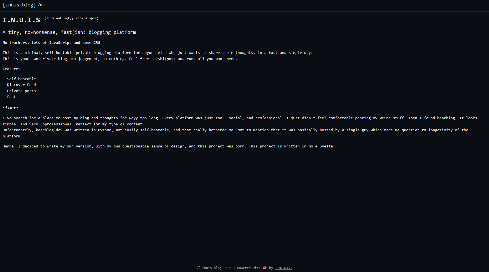
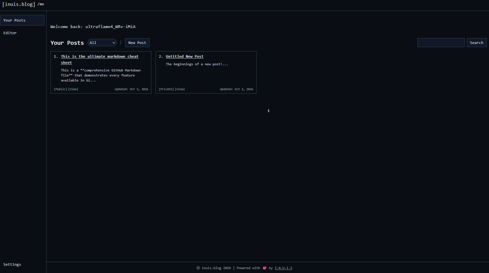
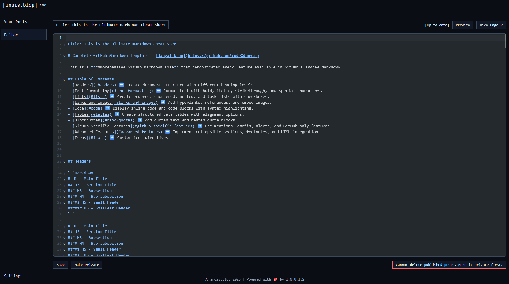
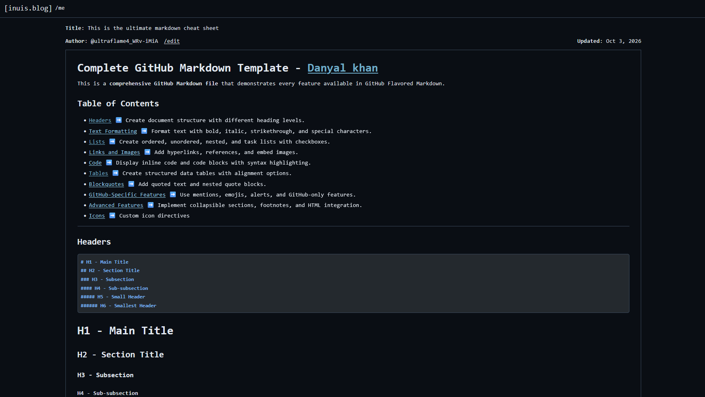

# I.N.U.I.S (It's not ugly, it's simple)

A tiny, no-nonsense, fast blogging platform written in Go.

No trackers, minimal JavaScript, and some CSS. Self-hostable, cheap to run, and feels private.

## Key Goals

- **Self-hostable** — easily self hostable as a single binary.
- **Cheap to run** — minimal resource footprint
- **Public API** — Fetch posts easily for integration into portfolio websites. (*only for published posts)
- **Private** — Pen your thoughts freely. Don't worry about public judgement.
 
## Documentation

| Section | Description |
|---|---|
| [Getting Started](docs/getting-started.md) | Overview, first startup, quick start |
| [Configuration](docs/configuration.md) | Environment variables and settings |
| [Deployment](docs/deployment.md) | Single-server and multi-server setups |
| [Identity Providers](docs/identity-providers.md) | OIDC provider setup |
| [User Management](docs/user-manage.md) | Signup, invite codes, admin setup |
| [API Reference](docs/api.md) | Route overview → [full specs](API_SPECS.md) |

## Quick Start

```bash
go run main.go
```

On first startup, a single-use invite code is printed to the logs. Use it to create your admin account.


# Images





